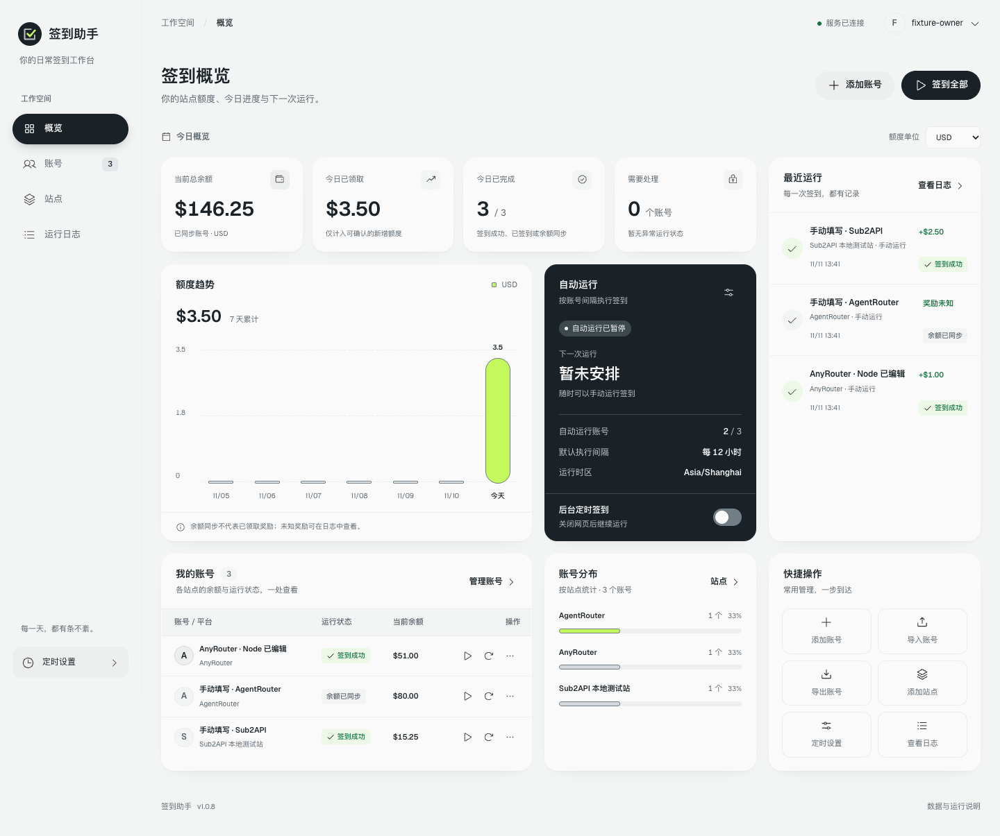
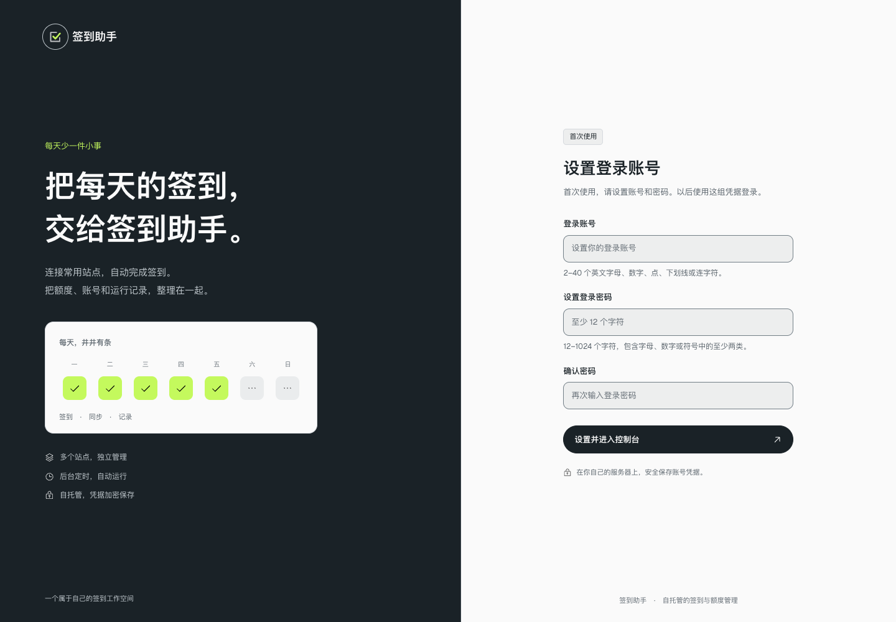

# 签到助手

自托管的站点签到与额度管理工具。集中管理 AnyRouter、AgentRouter 和兼容 New API / Sub2API 的站点账号，查看余额、运行记录与每日新增额度，支持 **1Panel、Docker Compose 和本地运行**。

使用 **Node.js 24 + TypeScript** 和原生网页前端，部署无需 Python。桌面和手机均可使用。



## 功能

- 多站点账号管理，支持手填 Session / 登录 Token，以及 AgentRouter 本站账号密码。
- 后台定时运行与手动签到，关闭网页后任务继续执行。
- 余额、签到结果、每日额度趋势与运行日志；USD、CNY 和站点积分分别统计。
- 密码加密的账号导入与导出，也可使用普通 JSON；导入先预览，重复账号自动跳过。
- 自定义站点模板、账号执行间隔和独立代理设置。
- 首次访问设置登录账号和密码；管理员密码使用 PBKDF2 哈希，站点凭据加密保存。

## Docker / 1Panel 部署

下载本仓库源码并解压到服务器目录，例如 `/opt/checkin-assistant`。在项目目录执行：

```bash
cp .env.example .env
# 编辑 .env，把 CHECKIN_PUBLIC_URL 改为实际访问网址
docker compose build --pull
docker compose up -d
docker compose ps
```

默认端口绑定 `127.0.0.1:8765`，使用 1Panel 的 HTTPS 反向代理访问。也可在 **容器 → 编排 → 创建编排 → 路径选择** 中选择项目的 `docker-compose.yml`。完整步骤见 [1Panel 部署指南](docs/deploy-1panel.md)。

首次打开网页，填写登录账号、密码和确认密码，设置成功后进入控制台。默认没有账号或密码，也无需初始化令牌。以后使用设置的凭据登录；重复设置和修改环境变量不会覆盖已有管理员。



## 站点账号怎么填

| 站点 / 方式 | 需要填写 | 后台行为 |
|---|---|---|
| AnyRouter | 本站 `session` Cookie、站内用户 ID | 身份校验、查询余额与签到 |
| AgentRouter，账号密码 | 本站用户名或邮箱、站内密码 | 在任务中登录，查询余额并核对签到结果 |
| AgentRouter，Session | 本站 `session` Cookie、站内用户 ID | 查询并同步余额 |
| Sub2API | 本站登录 Token、用户 ID，可选刷新 Token | 查询余额、签到及必要的 Token 刷新 |
| 自定义站点 | 按所选模板填写 Session / Token 或账号密码 | 使用配置的身份、余额和签到接口 |

Session 与用户 ID 在原站登录后获取：在浏览器开发者工具 **Application → Cookies** 复制该站 `session` 的原值，在 **Local Storage → user** 查看 `id`。Sub2API 通常使用 **Local Storage → auth_token** 和 `user.id`。只填写字段值；原站的模型 API Key、GitHub / LinuxDO 密码不能替代站点登录凭据。

网页会打开原站的独立登录页，登录完成后由你手工填写凭据，无需浏览器扩展。Session 保存前只读校验身份与余额；账号密码先加密保存，在运行任务时验证登录。

**余额已同步与签到成功分别记录。** AgentRouter 的 Session 方式只同步余额；账号密码方式只有当次登录响应明确返回 `checked_in === true` 才记为签到成功。无法确认的奖励显示未知。服务器网络、站点防护和凭据有效期可能影响运行，具体原因会显示在日志中。

## 账号导入与导出

在「账号」页导出全部账号或当前筛选结果，默认使用密码加密的 JSON，也可选择普通 JSON。文件包含站点凭据、备注、执行间隔、代理和关联的自定义站点配置。普通 JSON 的凭据可读，应妥善保管。

导入支持最多 **500 个账号、8 MiB**，先预览新增、重复和无效项，再确认保存。已有账号和站点不会被覆盖，失败时不会部分写入，重试同一次导入不会重复新增。新账号默认暂停自动运行，可选择恢复文件中的启用状态。

导入不执行站点登录或签到，不恢复管理员、余额和运行历史。跨安装导入会用目标安装的密钥重新加密凭据；完整安装备份仍需保存数据库与原密钥。

## 本地运行

安装 **Node.js 24.13 或更新的 24.x 版本**以及系统 Chrome / Chromium：

```bash
npm ci
npm run build
CHECKIN_HOST=127.0.0.1 CHECKIN_PUBLIC_URL=http://127.0.0.1:8765 npm start
```

打开 [http://127.0.0.1:8765/](http://127.0.0.1:8765/) 完成首次设置。上面的环境变量写法适用于 macOS / Linux；其他系统可将变量放在项目目录的 `.env` 中，再运行 `npm start`。`CHECKIN_BROWSER_PATH` 可指定 Chrome / Chromium 可执行文件，`npm run dev` 用于后端开发。

## 数据与运行

应用为单管理员、单进程服务。默认数据目录为 `data/`，Docker 内为 `/data`，其中包含 `checkin-assistant.db` 与 `secret.key`。**备份和迁移时必须一起保存数据库和密钥**；丢失密钥将无法解密站点凭据。升级前停止服务并备份完整数据目录，不让多个应用进程同时写同一个数据库。

Docker 镜像包含系统无头 Chromium，用于公开站点探测、必要的只读身份校验与后台任务。原站登录使用用户自己的浏览器，服务器校验与任务使用服务器网络。每个账号可选择直连或独立代理；容器中的 `127.0.0.1` 指容器本身，访问宿主机代理可使用 `host.docker.internal`。

## 开发与验证

```bash
npm run build
npm test
npm run test:ui
npm run test:ui:accounts

docker build -t checkin-assistant:test .
node tests-node/docker-smoke.mjs --image checkin-assistant:test
```

网页测试需要系统 Chrome / Chromium，Docker 验证需要 Docker。测试使用临时数据和本地模拟站点，完整流程见 [验证说明](docs/web-verification.md)。

生成 1Panel 源码部署包，需要系统提供 `tar` 与 `unzip`：

```bash
npm run package:web -- ./release
```

输出 ZIP、tar.gz 与 SHA-256 校验文件；包内不包含本地配置、数据库、密钥或依赖目录。

## 许可

项目采用 [MIT 许可证](LICENSE)。第三方组件的版权与许可见 [THIRD_PARTY_NOTICES.md](THIRD_PARTY_NOTICES.md)。
